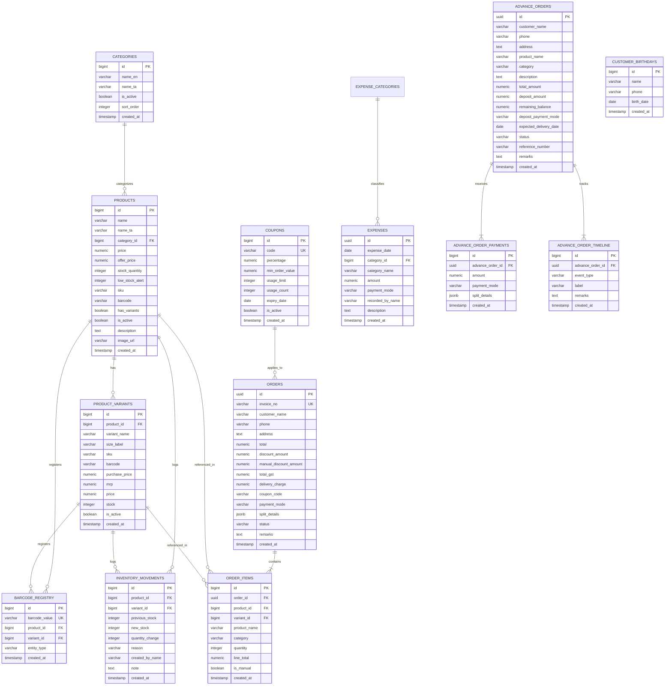

# 07 - API Endpoints, Network Contracts & Inferred Data Model

Comprehensive technical specification of the backend API architecture, database schema, table relations, and client/server storage contracts observed on the reference retail application.

---

## 1. Network Traffic & API Endpoint Registry

The reference application connects directly to a **Supabase PostgreSQL** backend via PostgREST HTTP endpoints (`https://<supabase-id>.supabase.co/rest/v1/...`).

### Observed REST Endpoints
| HTTP Method | Endpoint Path | Query / Filter Parameters | Request Body / Payload | Response Shape Summary | Status Codes |
|---|---|---|---|---|---|
| `GET` | `/rest/v1/products` | `select=...&order=sort_order.asc` | None | Array of product records with English/Tamil titles, prices, stock limits | `200 OK` |
| `GET` | `/rest/v1/product_variants` | `select=...&is_active=eq.true&order=sort_order.asc` | None | Array of variant records (size, SKU, barcode, cost, selling price) | `200 OK` |
| `GET` | `/rest/v1/categories` | `select=id,name_en,name_ta,is_active,sort_order` | None | Array of catalog category definitions | `200 OK` |
| `GET` | `/rest/v1/orders` | `select=...&order=created_at.desc&limit=1000` | None | Historical orders, payment methods, split details, grand totals | `200 OK` |
| `GET` | `/rest/v1/order_items` | `select=...&order_id=in.(...)` | None | Itemized order lines with quantities, line totals, and product IDs | `200 OK` |
| `GET` | `/rest/v1/coupons` | `select=...&is_active=eq.true` | None | Promotional discount codes, percentages, expiry dates, limits | `200 OK` |
| `GET` | `/rest/v1/expenses` | `select=*&order=expense_date.desc,created_at.desc` | None | Operational expenses, categories, amounts, cashier names | `200 OK` |
| `GET` | `/rest/v1/customer_birthdays` | `select=id,name,phone,birth_date,created_at` | None | Customer loyalty birthday directory | `200 OK` |
| `POST` | `/rest/v1/rpc/create_order_without_stock` | RPC call | `{ p_customer_name, p_items, p_total, p_payment_method, p_split_details, ... }` | Returns `{ order_id, invoice_no, created_at }` | `200 OK` |
| `POST` | `/rest/v1/rpc/adjust_inventory_stock` | RPC call | `{ p_product_id, p_variant_id, p_new_quantity, p_reason, p_created_by_name }` | Returns `{ success: true, updated_stock }` | `200 OK` |
| `POST` | `/rest/v1/rpc/create_advance_order` | RPC call | `{ p_customer_name, p_phone, p_total_amount, p_deposit_amount, ... }` | Returns `{ order_id, status }` | `200 OK` |
| `POST` | `/rest/v1/rpc/complete_advance_order_v2` | RPC call | `{ p_order_id, p_payment_method, p_final_amount, ... }` | Returns `{ completed_order_id, invoice_no }` | `200 OK` |

---

## 2. Authentication & Authorization Mechanism

### Observed Reference Implementation
- **Mechanism**: Pure client-side authentication.
- **Session Storage**: Sets `{ isLoggedIn: true, role: "admin", adminId: "admin" }` in browser `sessionStorage` under key `the-one-admin-session`.
- **API Headers**: Direct calls to Supabase use public anonymous API key (`apikey: <anon_key>` and `Authorization: Bearer <anon_key>`).
- **Security Assessment**: Highly vulnerable. Any user can inspect credentials in JavaScript bundles or bypass authentication entirely.

### Target Implementation for Stage 2 (Mandatory Upgrade)
- Real backend API routes in Next.js (`/api/auth/login`, `/api/orders`, `/api/inventory`).
- Password hashing with **Argon2id** or **Bcrypt**.
- **httpOnly, Secure, SameSite=Strict session cookies** or signed JWTs.
- Server-side role-based access control (RBAC): `ADMIN` vs `CASHIER`.
- Server-side price recalculation (never trust client-sent order totals).

---

## 3. Client Storage vs Server Storage Registry

| Storage Mechanism | Key Name | Purpose | Data Format |
|---|---|---|---|
| `sessionStorage` | `the-one-admin-session` | Current login session flag and cashier ID | JSON object |
| `localStorage` | `the_one_expenses_records_v1` | Local offline backup cache for expenses | JSON array of expense records |
| `localStorage` | `the_one_birthdays_v1` | Local cache of customer birthdays | JSON array |
| `localStorage` | `dashboard-sidebar-collapsed` | Sidebar visual collapsed toggle preference | String (`"0"` or `"1"`) |
| `localStorage` | `the-one-auth` | Zustand persisted auth store state | JSON object |
| Server Database | Supabase PostgreSQL | Master persistent source of truth | Relational tables |

---

## 4. Entity-Relationship (ER) Data Model

